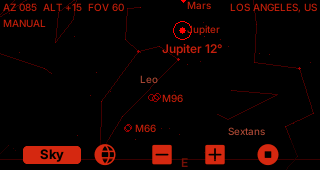
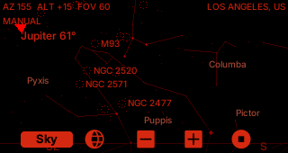
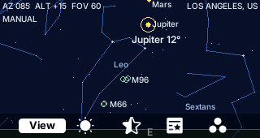
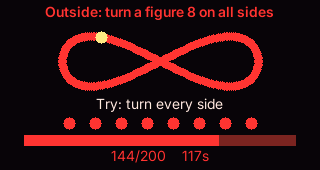
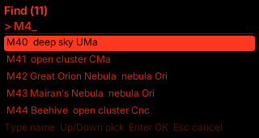

# ZeroSky

[](https://github.com/sponsors/andreahaku) [](https://ko-fi.com/andreahaku)

ZeroSky is a pocket planetarium for the [M5Stack CardputerZero](https://docs.m5stack.com/en/CardputerZero). It computes the sky for the current time and location and draws stars, constellation figures and names, deep-sky objects, the Sun, Moon and planets around the direction you point. Search guidance shows a ring or an edge arrow and uses rising audio cues as you approach a target.

**[User manual](docs/manual.md)**: every key on every page, the camera alignment and the compass calibration. The manual and the in-app help (H) exist in seven languages.

| Night sky with constellation names | Find: ring on the target | Find: arrow to an off-screen target |
| --- | --- | --- |
|  |  |  |

| Day theme | Compass calibration | Find: search by name |
| --- | --- | --- |
|  |  |  |

Version 1.0.0. The desktop simulator and host tests run, and a Debian trixie cross-build produces an arm64 `.deb`. The app, probe, speaker and camera background have run on a physical CardputerZero v5. Its sensor axes have been measured, the `cap` magnetometer profile has been calibrated outdoors with the probe and with the in-app page, and the Sun has been used for a first pointing check. Night-sky pointing accuracy and the camera lens alignment remain to be measured. Plate solving is a later phase.

## Install

From the CardputerZero AppStore, install **ZeroSky**. To install a package by hand:

```bash
sudo apt install ./zerosky_1.0.0_arm64.deb
```

The package pulls its Debian dependencies (`rpicam-apps-core`, `pipewire-alsa`, `fonts-droid-fallback` and the shared libraries) and installs everything under `/usr/share/zerosky`. A udev rule sets the BMM150 magnetometer to 30 Hz; it applies at the next boot.

## What works now

- Astronomy Engine computes topocentric Sun, Moon and planet positions. A derived HYG v4.1 catalog provides 5,070 stars to magnitude 6; a derived OpenNGC selection adds 605 Messier, NGC and IC objects. Western constellation figures and the positions of their Latin names come from a fixed d3-celestial revision.
- The sky has red night and blue day themes. The visible star limit changes with solar altitude, from daylight through civil, nautical and astronomical twilight. The View page can show the night catalog during daylight for exploration.
- Enter a city from the offline GeoNames index, type latitude and longitude, or choose a GNSS fix from a USB receiver or the Cap LoRa-1262-GPS. The location is shared with ZeroRadio through its existing location file.
- On the device, an IIO sensor source and Mahony filter steer altitude and roll after the physical axes are verified. Without a valid magnetic profile, `tilt only` uses a gyro heading with arbitrary north; left/right arrows align it. With an outdoor calibration, WMM2025 and the selected magnetometer profile provide true-north steering. Manual camera control remains available.
- The IMX219 camera can show a live image behind the sky marks. A high-contrast overlay keeps lines and labels readable over the image. Camera Align lets you adjust the drawn sky to the lens at night; its initial 62.2° horizontal FOV is only an estimate.
- The Set page opens a full-screen compass calibration: a red figure 8 shows the motion, eight dots and a bar show coverage, and two tones announce the fit. The View page switches constellation lines, their Latin names and the deep-sky objects.
- During Find, variometer-style beeps get faster and higher as you approach, and key 8 turns into a stop sign that ends the guidance.
- `zerosky_probe` prints raw sensors and orientation, saves a verified frame mapping, and captures magnetic calibration profiles. See [the field probe guide](docs/probe.md).

## Controls

The bottom bar has four pages: **Sky**, **View**, **Cam** and **Set**. Press **4** to advance; hold 4 to switch back. **H** opens in-app help. On the CardputerZero, F/X/Z/C also act as up/down/left/right outside text entry.

| Control | Action |
| --- | --- |
| Arrows, or F/X/Z/C | Move the manual camera by 5 degrees. In `tilt only`, left/right align the gyro heading; up/down follow the IMU. |
| Arrows in Align | Push the drawn sky in the arrow's direction by 0.5° per press. |
| TAB | Switch between IMU steering and manual camera on the device. The desktop simulator stays manual. |
| Sky: 5 | Open location entry. |
| Sky: 6 / 7 | Zoom out / in (horizontal field of view 120 to 15 degrees). |
| Sky: 8 (magnifying glass) | Open Find for the Sun, Moon, planets, named stars and deep-sky objects. While guiding, 8 shows a stop sign: press it to stop the guidance and the beeps. |
| View: 5 | Switch between red night and blue day themes. |
| View: 6 | Choose daylight filtering: half star (Dim) or full star (All). |
| View: 7 | Cycle constellations: hidden, lines only, lines with Latin names. |
| View: 8 | Show or hide the Messier, NGC and IC objects. Find still finds them. |
| Set: 5 | Choose the language: Auto (translate icon), EN, IT, FR, DE, ES, JA, ZH. Applies at the next start. |
| Set: 6 | Cycle the magnetic hardware configuration: `none`, `cap`, `usb_gps`. |
| Set: 7 | Open About, the manual QR code and Credits. |
| Set: 8 (compass) | Open the compass calibration page for the selected hardware profile. Use it outdoors. |
| Cam: 5 (camera / crossed camera) | Switch the live camera background on or off. The first frame may take a few seconds. |
| Cam: 6 (crosshair / check mark) | Enter Align; press again on **Done** to save if you changed the alignment. |
| Cam: 7 / 8 | In Align, narrow / widen the lens FOV by 1°. |
| ESC | Leave the app. Unsaved Align changes are discarded. |

Find accepts part of an object's name or catalog designation. An off-screen target gets an edge arrow with its name and angular distance. When it enters the field, a ring marks it. Audio cues become faster and higher as the separation decreases; a target below the horizon gives no beep. Use `ZEROSKY_TARGET` to select a target at startup for a demo.

At first launch, the location dialog opens automatically. Type a city name or coordinates such as `36.05, 14.24`, or wait for a GPS fix. Choose a row with up/down and press Enter. The saved location is reused on later starts. The choice of location source does not select a magnetic calibration profile.

With the camera on, the image replaces the drawn sky background; constellation lines, object marks and guidance stay on top. The Sky zoom keys are disabled because the view uses the lens FOV. At night, point at a region with known stars, open **Cam: 6 Align**, and push the drawn central star toward its photographed match with the arrows: right moves the drawing right. Then use **Cam: 7 / 8** to match another star near an edge. Press **Done** to save changed values; switching the camera off or leaving with ESC discards unfinished changes. Until an alignment is saved, the status line says `FOV estimated` outside Align and 62.2° remains a provisional FOV. See the [manual](docs/manual.md) for the full procedure.

Night/day theme, daylight filtering, constellation display, deep-sky display, camera on/off and the ordinary Sky zoom are restored from `~/.config/zerosky/settings` (or `$XDG_CONFIG_HOME/zerosky/settings`). Sky zoom is saved when you leave the app, rather than after each key press. Lens FOV and pointing offsets are saved separately in `camera-alignment`. `ZEROSKY_*` environment settings take precedence when supplied at startup.

The top status line shows azimuth, altitude, field of view and location. `manual` means the keys steer the camera; `axes not measured` means the device needs a saved frame mapping; `no IMU` means sensor discovery failed. `tilt only` means altitude and roll follow the IMU while the gyro heading has arbitrary north and may drift. Left/right arrows align it with the real sky. Once the selected hardware setup has a valid outdoor magnetic calibration, the compass supplies true north and `tilt only` disappears. `compass disturbed` means the measured field failed the disturbance check; the IMU can still steer, but its heading should not be trusted. Press TAB for manual control in that case.

## Language

The interface, the in-app help and the [manual](docs/manual.md) exist in English, Italian, French, German, Spanish, Japanese and Simplified Chinese. **Set: 5** picks the language (Auto follows the system) and saves it in `~/.config/zeroradio/lang`; it applies at the next start. At startup the app reads `ZERORADIO_LANG`, then that file, then `LC_ALL`, `LC_MESSAGES` and `LANG`. Translated docs sit next to the English ones as `name.<code>.md` (for example `docs/manual.it.md`); a missing translation falls back to English. Japanese and Chinese text uses a system CJK fallback font.

## Build and test

Desktop simulator (SDL):

```sh
cmake --preset linux-x86-64
cmake --build --preset linux-x86-64-dbg
ctest --test-dir build/linux-x86-64 -C Debug --output-on-failure
build/linux-x86-64/Debug/zerosky
```

The device build runs in a Debian trixie container to match the CardputerZero's glibc and libstdc++:

```sh
scripts/cp0-docker-build.sh
scripts/cp0-docker-build.sh --package
```

The second command also produces the arm64 Debian package with the app, sky and city data, fonts, WMM coefficients, icon, in-app help, Credits and `zerosky_probe`. The installed probe is at `/usr/share/zerosky/bin/zerosky_probe`.

## First use on the device

1. Use `zerosky_probe` to identify accelerometer, gyroscope and magnetometer axes. Check several faces and rotations against a physical reference. The CardputerZero v5 mapping measured for this project is recorded in [docs/probe.md](docs/probe.md); verify it on other units.
2. Once the frame rotations and pointing/screen-up directions are confirmed, save them with `zerosky_probe --save-frames`, the four frame options and the measured `--mag-to-body` rotation. This writes `~/.config/zerosky/frame-mapping.json`.
3. Outdoors, calibrate the compass for each physical configuration you will use (`none`, `cap`, `usb_gps`): select it with **Set: 6**, press **Set: 8** and move the device in a figure 8 through every side until the capture stops. Enter saves `~/.config/zerosky/magnetometer-calibration.json` only if the fit passes its quality checks. `zerosky_probe --capture` does the same from a shell.
4. Select the matching hardware configuration on the Set page. `ZEROSKY_HARDWARE` overrides the saved choice for controlled runs. If no matching profile exists, the compass remains unreliable and the app uses `tilt only` while the IMU is available.

The exact commands and safety checks are in [docs/probe.md](docs/probe.md). Hardware detection is currently manual; the design and unresolved presence checks are in [docs/hardware-detection.md](docs/hardware-detection.md).

The [full user manual](docs/manual.md) covers first use, navigation, search, status messages and troubleshooting. Set: 7 shows an About page with its QR code, which opens the manual in the selected language.

## Data and licenses

The application code is [MIT licensed](LICENSE). Bundled data and third-party code keep their own notices:

| Component | Source | License |
| --- | --- | --- |
| App shell and shared location | Vendored ZeroRadio toolkit | MIT |
| Sun, Moon and planets | Astronomy Engine C v2.1.19, Don Cross | MIT |
| Stars, names and designations | HYG v4.1 derived `stars.tsv`, David Nash / Astronexus | CC BY-SA 4.0 |
| Deep-sky objects (Messier, NGC, IC) | OpenNGC, Mattia Verga, selection in `deep_sky.tsv` | CC BY-SA 4.0 |
| Western constellation figures | d3-celestial, Olaf Frohn; IAU / Sky & Telescope charts | BSD-3-Clause and CC BY 4.0 |
| Offline cities | GeoNames cities15000 | CC BY 4.0 |
| Magnetic field and declination | NOAA / BGS World Magnetic Model 2025 | US Government public domain material |
| Fonts | Bundled font files | See `assets/fonts/LICENSE.txt` |

See [CREDITS.md](CREDITS.md), [docs/data-sources.md](docs/data-sources.md) and the license files shipped beside the derived assets for exact revisions, transformations and attribution. The constellation figures are illustrative western line drawings, not official IAU constellation boundaries.
