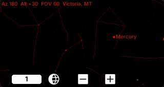

# ZeroSky

ZeroSky is a pocket planetarium for the [M5Stack CardputerZero](https://docs.m5stack.com/en/CardputerZero). It computes the sky for the current time and location and draws stars, constellation figures, the Sun, Moon and planets around the direction you point. Search guidance shows a ring or an edge arrow and uses rising audio cues as you approach a target.

The app is in active development. The desktop simulator and host tests run, and a Debian trixie cross-build produces an arm64 `.deb`. The app, probe and speaker have run on a physical CardputerZero v5; its sensor axes and pointing direction have been measured. Outdoor magnetic calibration and pointing accuracy still need validation. Camera imagery and plate solving are later phases.



## What works now

- Astronomy Engine computes topocentric Sun, Moon and planet positions. A derived HYG v4.1 catalog provides 5,070 stars to magnitude 6; a derived OpenNGC selection adds 605 Messier, NGC and IC objects. Western constellation figures come from a fixed d3-celestial revision.
- The sky has red night and blue day themes. The visible star limit changes with solar altitude, from daylight through civil, nautical and astronomical twilight. The View page can show the night catalog during daylight for exploration.
- Enter a city from the offline GeoNames index, type latitude and longitude, or choose a GNSS fix from a USB receiver or the Cap LoRa-1262-GPS. The location is shared with ZeroRadio through its existing location file.
- On the device, an IIO sensor source and Mahony filter steer altitude and roll after the physical axes are verified. Without a valid magnetic profile, `tilt only` uses a gyro heading with arbitrary north; left/right arrows align it. With an outdoor calibration, WMM2025 and the selected magnetometer profile provide true-north steering. Manual camera control remains available.
- `zerosky_probe` prints raw sensors and orientation, saves a verified frame mapping, and captures magnetic calibration profiles. See [the field probe guide](docs/probe.md).

## Controls

The bottom bar has two pages. Press **4** to switch between **Sky** and **View**; hold 4 to switch back. **H** opens in-app help. On the CardputerZero, F/X/Z/C also act as up/down/left/right outside text entry.

| Control | Action |
| --- | --- |
| Arrows, or F/X/Z/C | Move the manual camera by 5 degrees. In `tilt only`, left/right align the gyro heading; up/down follow the IMU. |
| TAB | Switch between IMU steering and manual camera on the device. The desktop simulator stays manual. |
| Sky: 5 | Open location entry. |
| Sky: 6 / 7 | Zoom out / in (horizontal field of view 120 to 15 degrees). |
| Sky: 8 | Open Find for the Sun, Moon, planets, named stars and deep-sky objects. Hold 8 to stop guidance. |
| View: 5 | Switch between red night and blue day themes. |
| View: 6 | Choose daylight filtering: Dim or All. |
| View: 7 | Cycle the magnetic hardware configuration: `none`, `cap`, `usb_gps`. |
| View: 8 | Open About, the manual QR code and Credits. |
| ESC | Leave the app. |

Find accepts part of an object's name or catalog designation. An off-screen target gets an edge arrow with its name and angular distance. When it enters the field, a ring marks it. Audio cues become faster and higher as the separation decreases; a target below the horizon gives no beep. Use `ZEROSKY_TARGET` to select a target at startup for a demo.

At first launch, the location dialog opens automatically. Type a city name or coordinates such as `36.05, 14.24`, or wait for a GPS fix. Choose a row with up/down and press Enter. The saved location is reused on later starts. The choice of location source does not select a magnetic calibration profile.

The top status line shows azimuth, altitude, field of view and location. `manual` means the keys steer the camera; `axes not measured` means the device needs a saved frame mapping; `no IMU` means sensor discovery failed. `tilt only` means altitude and roll follow the IMU while the gyro heading has arbitrary north and may drift. Left/right arrows align it with the real sky. Once the selected hardware setup has a valid outdoor magnetic calibration, the compass supplies true north and `tilt only` disappears. `compass disturbed` means the measured field failed the disturbance check; the IMU can still steer, but its heading should not be trusted. Press TAB for manual control in that case.

## Build and test

Desktop simulator (SDL):

```sh
cmake --preset linux-x86-64
cmake --build --preset linux-x86-64-dbg
ctest --test-dir build/linux-x86-64 -C Debug --output-on-failure
build/linux-x86-64/Debug/zerosky
```

The device build runs in a Debian trixie container to match the CardputerZero's glibc and libstdc++:

```sh
scripts/cp0-docker-build.sh
scripts/cp0-docker-build.sh --package
```

The second command also produces the arm64 Debian package with the app, sky and city data, fonts, WMM coefficients, icon, in-app help, Credits and `zerosky_probe`. The installed probe is at `/usr/share/zerosky/bin/zerosky_probe`.

## First use on the device

1. Use `zerosky_probe` to identify accelerometer, gyroscope and magnetometer axes. Check several faces and rotations against a physical reference. The CardputerZero v5 mapping measured for this project is recorded in [docs/probe.md](docs/probe.md); verify it on other units.
2. Once the frame rotations and pointing/screen-up directions are confirmed, save them with `zerosky_probe --save-frames` and the four required frame options. This writes `~/.config/zerosky/frame-mapping.json`.
3. Outdoors, capture a separate magnetometer profile for each physical configuration you will use (`none`, `cap`, `usb_gps`). Give the probe position, date and a measured `--mag-to-body` rotation. It saves `~/.config/zerosky/magnetometer-calibration.json` only if the fit passes its quality checks.
4. Select the matching hardware configuration on the View page. `ZEROSKY_HARDWARE` overrides the saved choice for controlled runs. If no matching profile exists, the compass remains unreliable and the app uses `tilt only` while the IMU is available.

The exact commands and safety checks are in [docs/probe.md](docs/probe.md). Hardware detection is currently manual; the design and unresolved presence checks are in [docs/hardware-detection.md](docs/hardware-detection.md).

The [full user manual](docs/manual.md) covers first use, navigation, search, status messages and troubleshooting. View: 8 shows an About page with its QR code.

## Data and licenses

The application code is [MIT licensed](LICENSE). Bundled data and third-party code keep their own notices:

| Component | Source | License |
| --- | --- | --- |
| App shell and shared location | Vendored ZeroRadio toolkit | MIT |
| Sun, Moon and planets | Astronomy Engine C v2.1.19, Don Cross | MIT |
| Stars, names and designations | HYG v4.1 derived `stars.tsv`, David Nash / Astronexus | CC BY-SA 4.0 |
| Deep-sky objects (Messier, NGC, IC) | OpenNGC, Mattia Verga, selection in `deep_sky.tsv` | CC BY-SA 4.0 |
| Western constellation figures | d3-celestial, Olaf Frohn; IAU / Sky & Telescope charts | BSD-3-Clause and CC BY 4.0 |
| Offline cities | GeoNames cities15000 | CC BY 4.0 |
| Magnetic field and declination | NOAA / BGS World Magnetic Model 2025 | US Government public domain material |
| Fonts | Bundled font files | See `assets/fonts/LICENSE.txt` |

See [CREDITS.md](CREDITS.md), [docs/data-sources.md](docs/data-sources.md) and the license files shipped beside the derived assets for exact revisions, transformations and attribution. The constellation figures are illustrative western line drawings, not official IAU constellation boundaries.
